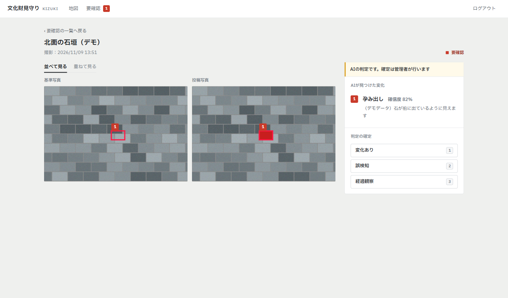
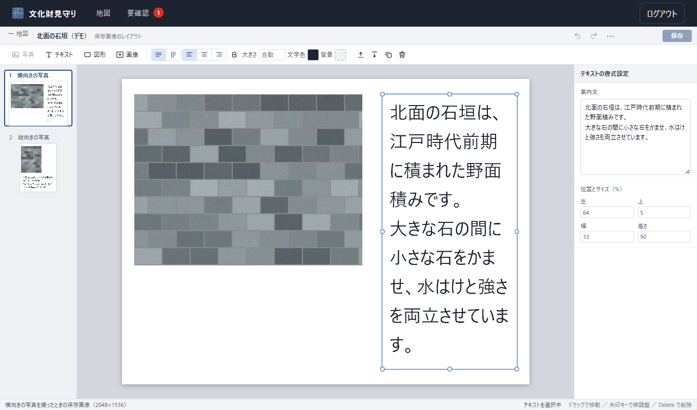
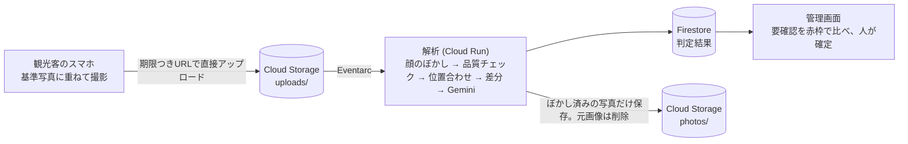

# KIZUKI（文化財見守り）

観光客が撮る「同じ角度の1枚」を積み重ねて、文化財（城の石垣など）の小さな変化に早く気づくシステムです。

[](LICENSE)


GDGoC Japan DevFest Hackathon 2026（観光カテゴリ）の出品作品です。

> **AI は「要確認」を出すまでです。「変化あり」と確定するのは、必ず人（管理者・専門家）です。**

| 比較して確定する（管理画面） | 保存画像のレイアウトを編集する（管理画面） |
|---|---|
|  |  |

## なぜつくるのか

石垣のような文化財は、写真測量や3次元レーザー計測で精密に調べられます。ただ、費用と手間がかかるので、頻繁にはできません。計測と計測の間に起きた小さな変化（石の緩み、割れ、孕み出し、樹木の侵入）は、次の計測まで見つかりません。

一方、城には毎日たくさんの観光客が訪れ、同じ場所でスマホの写真を撮っています。KIZUKI は、その写真を「同じ角度」にそろえて集め、前の写真と比べます。目的は、精密計測の代わりになることではありません。**専門家がどこを見に行くべきかの優先順位をつける、一次点検**です。

## しくみ



解析は2段階です。**画像処理で候補を絞り、Gemini が意味を判定します。** 画像処理だけでは影と割れを区別できず、Gemini だけで全体を比べると細部を見落とし、費用もかさむためです。

1. **顔のぼかし。** Cloud Vision で顔を検出してぼかします。ぼかした画像だけを残し、元画像は削除します。
2. **品質チェック。** ブレと暗さは数値で、対象が隠れていないかと逆光は Gemini で判定します。不合格の写真は画像を保存せず、理由だけを記録します。
3. **位置合わせ。** OpenCV（SIFT と RANSAC）で基準写真に重ねます。
4. **動くものの除外。** Cloud Vision の物体検出で、人や乗り物の範囲を見つけ、比べる対象から外します。人の動きを、変化と取り違えないためです。
5. **候補の抽出。** 明るさをそろえて差分を取り、差の大きい範囲を切り出します。
6. **変化の判定。** 候補の前後画像と観察項目を Gemini に渡し、構造化出力（JSON）で受け取ります。光・影・季節による違いは、変化に含めない指示にしています。

### 設計の方針

- **AI は確定しません。** 管理画面にも「AI の判定です。確定は管理者が行います」と明示しています。
- **観光客の位置情報は扱いません。** 取得も保存もしません。
- **個人情報を長く持ちません。** 元画像は処理後に削除し、失敗しても1日で消えるよう、ライフサイクルを設定しています。
- **API キーを使いません。** Gemini は Vertex AI を通し、サービスアカウントで認証します。
- **費用のかかる処理はモックに切り替えられます。** ローカルでは、Gemini と Vision を呼ばずに動かせます。

## 何ができるか

| 立場 | できること |
|---|---|
| 観光客（スマホ） | QR コードを読み、半透明の基準写真に重ねて撮影します。重なると自動でシャッターが切れます。ログインは要りません。撮った写真は、**管理者が設定した案内文つきの保存画像**にして持ち帰れます。 |
| 管理者・専門家（PC） | 地図で撮影ポイントを登録し、状態で色分けして見ます。「要確認」の写真を、基準写真と並べて（または重ねて）比べ、「変化あり」「誤検知」「経過観察」を確定します。保存画像のレイアウトも編集できます。 |

### 保存画像のレイアウト

観光客が保存する画像は、写真に管理者の案内文を添えた1枚です。管理者は、PowerPoint のような画面で、その配置を決めます。

- **向きごとに設定します。** 縦向きの写真用と横向きの写真用を別々に作り、スマホは撮った写真の向きで自動的に選びます。
- **部品：** 写真枠、テキスト（縦書き・横書き、文字の大きさ、色、背景色）、図形、画像（ロゴ）。
- **見たとおりに保存されます。** 編集画面とスマホが、同じ描画処理を使っています。
- 加工するのは、スマホ上の保存用コピーだけです。解析に送る写真は、そのままです。

## 使っている Google の技術

| 技術 | 使いどころ |
|---|---|
| Vertex AI（Gemini） | 変化の判定と、対象の隠れ・逆光の判定。構造化出力（JSON）で受け取ります |
| Cloud Run | API と解析処理。解析は、非公開で、使うときだけ起動します |
| Eventarc | 写真のアップロード完了をきっかけに、解析を起動します |
| Cloud Vision | 顔の検出（ぼかしのため）と、人・乗り物の検出（比べる対象から外すため） |
| Firestore / Cloud Storage | 判定結果と画像。署名付き URL で、ブラウザから直接やり取りします |
| Firebase Hosting / Authentication | 画面の配信。観光客は匿名ログイン、管理者は Google ログイン |
| Maps JavaScript API | 管理画面の地図 |
| Cloud Build / Artifact Registry | イメージのビルドと保管 |

## 動かしてみる（ローカル・約5分）

クラウドは不要です。パソコン1台で、撮影から管理画面での確認まで試せます。データは API のメモリ上にあり、止めると消えます。

**必要なもの：** Windows、Python 3.12、Node.js 24（npm 11）。動作確認は、この組み合わせです。

### 1. 準備（最初の1回だけ・PowerShell）

```powershell
cd C:\Users\haruk\Documents\KIZUKI
python -m venv .venv
.venv\Scripts\python -m pip install -r services/api/requirements.txt -r services/analyzer/requirements.txt pytest httpx
cd apps\capture; npm install
cd ..\admin; npm install
cd ..\..
```

パスは、自分の環境に合わせて読み替えてください。

### 2. 起動（PowerShell を3つ開く）

| # | 何を | コマンド | URL |
|---|---|---|---|
| ① | API | `cd services\api` → `..\..\.venv\Scripts\python -m uvicorn app.main:app --port 8080` | http://localhost:8080 |
| ② | 管理画面 | `cd apps\admin` → `npm run dev` | http://localhost:5174 |
| ③ | 撮影画面 | `cd apps\capture` → `npm run dev` | http://localhost:5173/capture/spot0001 |

API を起動すると、デモ用の撮影ポイント（`spot0001`）と「要確認」の判定が1件入ります。

### 3. 使ってみる

1. 管理画面（②）を開き、「**開発用ログイン**」を押します。
2. 地図で撮影ポイントを選び、「**レイアウトを編集**」で保存画像の案内文を入れて保存します。
3. 撮影画面（③）を開き、撮影して 「**保存**」を押すと、案内文つきの画像ができます。
4. 管理画面の 「**要確認**」で、比較画面（赤枠）と判定の確定を試します。

### 地図を表示するには（任意）

管理画面の地図は Google Maps を使います。キーがなくても、ほかの機能は動きます。

1. Google Cloud で **Maps JavaScript API** を有効にし、API キーを作ります（HTTP リファラーの制限をかけてください）。
2. `apps/admin/.env.example` を `apps/admin/.env.local` にコピーし、`VITE_GOOGLE_MAPS_API_KEY=` にキーを書きます。
3. 管理画面を再起動します。

`.env.local` は Git に入りません。**キーを README やコードに書かないでください。**

## iPhone の実機で撮影する

iPhone のカメラは、https のページでしか使えません。PC と iPhone を**同じ Wi-Fi**につないでから、次のように起動します。

1. PC の IP アドレスを調べます（PowerShell で `ipconfig`。Wi-Fi の「IPv4 アドレス」。つなぎ直すと変わります）。以下 `192.168.3.3` とします。
2. API を、次の環境変数つきで起動します（②の代わりに）。
   ```powershell
   cd services\api
   $env:CAPTURE_BASE_URL = "https://192.168.3.3:5173"
   ..\..\.venv\Scripts\python -m uvicorn app.main:app --port 8080
   ```
3. 撮影画面を、スマホ用のモードで起動します（③の代わりに）。
   ```powershell
   cd apps\capture
   npm run dev:phone
   ```
4. iPhone の Safari で `https://192.168.3.3:5173/capture/spot0001` を開き、証明書の警告は「詳細を表示」→「このWebサイトを閲覧」を選びます（自己署名のためで、自分の PC なので問題ありません）。

開けないときは、同じ Wi-Fi か（ゲスト用 Wi-Fi は端末どうしの通信を禁じることがあります）、Windows ファイアウォールでポート 5173 を許可したか、IP アドレスが変わっていないかを確認してください。詳しくは [docs/local-dev.md](docs/local-dev.md) にあります。

## 本物の Gemini を使う

既定では Gemini と顔検出はモックです（モックの判定は、差分のある所をすべて「変化あり」と返すので、精度は確かめられません）。本物を使うには、API を起動する前に設定します。

```powershell
$env:JUDGE_MODE = "vertex"
$env:GOOGLE_CLOUD_PROJECT = "<自分のプロジェクト ID>"
$env:GOOGLE_CLOUD_LOCATION = "global"
$env:GEMINI_MODEL_FAST = "gemini-3.8-flash"
```

認証は `gcloud auth application-default login` で保存した認証情報を使います。**API キーは使いません。** 費用がかかるので、使い終わったら環境変数を消してください。

## テスト

```powershell
cd services\analyzer; ..\..\.venv\Scripts\python -m pytest
cd ..\api;            ..\..\.venv\Scripts\python -m pytest
cd ..\..\apps\capture; npm test
cd ..\admin;           npm test
```

## 構成

| フォルダ | 内容 |
|---|---|
| `apps/capture` | 観光客の撮影画面（React + Vite、PWA） |
| `apps/admin` | 管理画面（React + Vite） |
| `services/api` | API（FastAPI） |
| `services/analyzer` | 解析処理（OpenCV + Gemini） |
| `shared` | データ型、保存画像の描画処理、保存先・DB の差し替え口 |
| `infra` | Firestore と Storage のルール、デプロイ手順 |
| `experiments` | 精度検証のスクリプト |
| `docs` | 設計メモ、ローカル開発、デモの手順 |

保存先とデータベースは、差し替え口（ポート）の裏に置いています。ローカルではメモリ上の実装、クラウドでは Firestore と Cloud Storage の実装に切り替わります。

**ドキュメント：** [構成の全体像](docs/architecture.md) ／ [ローカル開発](docs/local-dev.md) ／ [デモの流れ](docs/demo.md) ／ [デプロイ手順](infra/DEPLOY.md) ／ [設計の前提（CLAUDE.md）](CLAUDE.md)

## 現在の状況

| 項目 | 状況 |
|---|---|
| ローカルでの撮影 → 解析 → 管理画面での確認 | 動作確認済み |
| 実写（名古屋城の同じ構図 8組）での誤検知 | 0 件（Gemini 呼び出し 39 回） |
| クラウドへのデプロイ（Cloud Run・Firebase Hosting・Firestore・Eventarc） | 実施済み。撮影 → 解析 → 保存まで動作を確認（[infra/DEPLOY.md](infra/DEPLOY.md)） |
| 顔のぼかし（Vision）、品質チェック（Gemini） | クラウド上で動作を確認 |
| 保存画像のレイアウト編集 | ブラウザで確認済み。iPhone 実機は未確認 |
| 見逃しの検証 | 合成した変化で一部実施（`experiments/miss_check.py`）。細いひびとずれた石は検出、平らな色の四角は Gemini が「画像加工」として見送ります。実際の損傷での検証は未実施 |
| App Check | 切っています（回数制限を回避できるため、公開を続けるなら有効化が必要） |
| 変化の通知（FCM） | 未実装 |
| 多言語の案内文 | 後回し（日本語のみ） |

## これからの課題

- 見逃しの測定。実際の変化（シールなど）を加えた画像で、検出できる大きさを調べます。
- App Check の有効化。公開を続けるなら必要です。
- 変化の通知（FCM）と、管理画面の集計。
- 案内文の多言語化。

## このリポジトリに含まれないもの

- 秘密情報（`.env`、`.env.local`。API キーなど）
- サンプル写真（`ishigaki_samples/images`、`ishigaki_change_pairs/photos`）。Wikimedia Commons などの写真で、サイズが大きく、写真ごとにライセンスが異なるためです。出典とライセンスの一覧（`licenses.csv`）だけを含めています。
- 自分で撮った実写（`実写サンプル/`、`experiments/samples/` の写真）。人や場所が写るおそれがあるためです。
- 仮想環境、`node_modules`、実験の出力

## ライセンス

[MIT License](LICENSE)。ただし `ishigaki_samples` と `ishigaki_change_pairs` の写真は、それぞれの出典のライセンスに従います（一覧は各フォルダの `licenses.csv`）。
