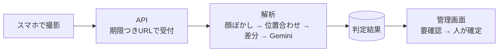

# KIZUKI（文化財見守り）

観光客が撮る「同じ角度の1枚」を積み重ねて、文化財（城の石垣など）の小さな変化に早く気づくシステムです。
GDGoC Japan DevFest Hackathon 2026（観光カテゴリ）の出品作品です。

> **AI は「要確認」を出すまで。「変化あり」と確定するのは、必ず人（管理者・専門家）です。**

## 何ができるか

| 立場 | できること |
|---|---|
| 観光客（スマホ） | QR コードを読み、半透明の基準写真に重ねて撮影します。重なったら自動でシャッターが切れます。撮った写真には、**管理者が設定した案内文つきの保存画像**を作れます。 |
| 管理者・専門家（PC） | 地図で撮影ポイントを登録・確認します。「要確認」の写真を、赤枠つきで基準写真と比べ、判定を確定します。**保存画像のレイアウト**（写真の位置、縦書き・横書きの案内文、図形、ロゴ）を、PowerPoint のような画面で編集します。 |
| 裏側（解析） | OpenCV で写真を位置合わせして差分を取り、変化の候補を絞ります。その候補を Gemini（Vertex AI）が判定します。 |



## 動かしてみる（ローカル・約5分）

クラウドは不要です。パソコン1台で、撮影から管理画面での確認まで試せます。データは API のメモリ上にあり、止めると消えます。

**必要なもの：** Windows、Python 3.12、Node.js 24（npm 11）。動作確認は、この組み合わせです。

### 1. 準備（最初の1回だけ・PowerShell）

```powershell
cd C:\Users\haruk\Documents\KIZUKI
python -m venv .venv
.venv\Scripts\python -m pip install -r services/api/requirements.txt -r services/analyzer/requirements.txt pytest httpx
cd apps\capture; npm install
cd ..\admin; npm install
cd ..\..
```

### 2. 起動（PowerShell を3つ開く）

| # | 何を | コマンド | URL |
|---|---|---|---|
| ① | API | `cd services\api` → `..\..\.venv\Scripts\python -m uvicorn app.main:app --port 8080` | http://localhost:8080 |
| ② | 管理画面 | `cd apps\admin` → `npm run dev` | http://localhost:5174 |
| ③ | 撮影画面 | `cd apps\capture` → `npm run dev` | http://localhost:5173/capture/spot0001 |

API を起動すると、デモ用の撮影ポイント（`spot0001`）と「要確認」の判定が1件入ります。

### 3. 使ってみる

1. 管理画面（②）を開き、**「開発用ログイン」**を押します。
2. 地図で撮影ポイントを選び、**「レイアウトを編集」**で保存画像の案内文を入れて保存します。
3. 撮影画面（③）を開き、撮影して **「保存」**を押すと、案内文つきの画像ができます。
4. 管理画面の **「要確認」**で、比較画面（赤枠）と判定の確定を試します。

### 地図を表示するには（任意）

管理画面の地図は Google Maps を使います。キーがなくても、ほかの機能は動きます。

1. Google Cloud で **Maps JavaScript API** を有効にし、API キーを作ります（HTTP リファラーの制限をかけてください）。
2. `apps/admin/.env.example` を `apps/admin/.env.local` にコピーし、`VITE_GOOGLE_MAPS_API_KEY=` にキーを書きます。
3. 管理画面を再起動します。

`.env.local` は Git に入りません。**キーを README やコードに書かないでください。**

## iPhone の実機で撮影する

iPhone のカメラは、https のページでしか使えません。PC と iPhone を**同じ Wi-Fi**につないでから、次のように起動します。

1. PC の IP アドレスを調べます（PowerShell で `ipconfig`。Wi-Fi の「IPv4 アドレス」。つなぎ直すと変わります）。以下 `192.168.3.3` とします。
2. API を、次の環境変数つきで起動します（②の代わりに）。
   ```powershell
   cd services\api
   $env:CAPTURE_BASE_URL = "https://192.168.3.3:5173"
   ..\..\.venv\Scripts\python -m uvicorn app.main:app --port 8080
   ```
3. 撮影画面を、スマホ用のモードで起動します（③の代わりに）。
   ```powershell
   cd apps\capture
   npm run dev:phone
   ```
4. iPhone の Safari で `https://192.168.3.3:5173/capture/spot0001` を開き、証明書の警告は「詳細を表示」→「このWebサイトを閲覧」を選びます（自己署名のためで、自分の PC なので問題ありません）。

開けないときは、同じ Wi-Fi か（ゲスト用 Wi-Fi は端末どうしの通信を禁じることがあります）、Windows ファイアウォールでポート 5173 を許可したか、IP アドレスが変わっていないかを確認してください。詳しくは [docs/local-dev.md](docs/local-dev.md) にあります。

## 本物の Gemini を使う

既定では Gemini と顔検出はモックです（モックの判定は、差分のある所をすべて「変化あり」と返すので、精度は確かめられません）。本物を使うには、API を起動する前に設定します。

```powershell
$env:JUDGE_MODE = "vertex"
$env:GOOGLE_CLOUD_PROJECT = "kizuki-hackathon"
$env:GOOGLE_CLOUD_LOCATION = "global"
$env:GEMINI_MODEL_FAST = "gemini-3.8-flash"
```

認証は `gcloud auth application-default login` で保存した認証情報を使います。**API キーは使いません。** 費用がかかるので、使い終わったら環境変数を消してください。

## テスト

```powershell
cd services\analyzer; ..\..\.venv\Scripts\python -m pytest
cd ..\api;            ..\..\.venv\Scripts\python -m pytest
cd ..\..\apps\capture; npm test
cd ..\admin;           npm test
```

## 保存画像のレイアウト（このシステムの特徴）

観光客が保存する画像は、写真に管理者の案内文を添えた1枚の画像になります。

- **向きごとに設定します。** 縦向きの写真用と横向きの写真用を、別々に作ります。スマホは、撮った写真の向きで自動的に選びます。
- **部品：** 写真枠、テキスト（縦書き・横書き、文字の大きさ、色、背景色）、図形、画像（ロゴ）。
- **編集画面：** スライド一覧、リボン、書式設定、ステータスバーを備えた、PowerPoint 風の画面です。見たとおりに保存されます（編集画面とスマホが、同じ描画処理を使います）。
- 加工するのは、スマホ上の保存用コピーだけです。解析に送る写真は、そのままです。

## 構成

| フォルダ | 内容 |
|---|---|
| `apps/capture` | 観光客の撮影画面（React + Vite、PWA） |
| `apps/admin` | 管理画面（React + Vite） |
| `services/api` | API（FastAPI） |
| `services/analyzer` | 解析処理（OpenCV + Gemini） |
| `shared` | データ型、保存画像の描画処理、保存先・DB の差し替え口 |
| `infra` | Firestore と Storage のルール、デプロイ手順 |
| `experiments` | 精度検証のスクリプト |
| `docs` | 設計メモ、ローカル開発、デモの手順 |

**ドキュメント：** [設計の前提（CLAUDE.md）](CLAUDE.md) ／ [構成の全体像](docs/architecture.md) ／ [ローカル開発](docs/local-dev.md) ／ [デモの流れ](docs/demo.md) ／ [デプロイ手順（案）](infra/DEPLOY.md)

## 現在の状況

| 項目 | 状況 |
|---|---|
| ローカルでの撮影 → 解析 → 管理画面での確認 | 動作確認済み |
| 実写（名古屋城の同じ構図 8組）での誤検知 | 0 件（Gemini 呼び出し 39 回） |
| 見逃しの検証 | 未実施（変化を加えた画像が必要） |
| 保存画像のレイアウト編集 | ブラウザで確認済み。iPhone 実機は未確認 |
| クラウド上の動作（Firestore・署名付きURL・Eventarc・Vision・App Check・認証・デプロイ） | **未確認** |
| 変化の通知（FCM） | 未実装（P1） |
| 多言語の案内文 | 後回し（日本語のみ） |

実行基盤は Cloud Run と Firebase Hosting の想定です。本番にはクラウド側の設定が要ります（[infra/DEPLOY.md](infra/DEPLOY.md)）。

## このリポジトリに含まれないもの

- 秘密情報（`.env`、`.env.local`。API キーなど）
- サンプル写真（`ishigaki_samples/images`、`ishigaki_change_pairs/photos`）。Wikimedia Commons などの写真で、サイズが大きく、写真ごとにライセンスが異なるためです。出典とライセンスの一覧（`licenses.csv`）だけを含めています。
- 自分で撮った実写（`実写サンプル/`、`experiments/samples/` の写真）。人や場所が写るおそれがあるためです。
- 仮想環境、`node_modules`、実験の出力

## ライセンス

[MIT License](LICENSE)。ただし `ishigaki_samples` と `ishigaki_change_pairs` の写真は、それぞれの出典のライセンスに従います（一覧は各フォルダの `licenses.csv`）。
