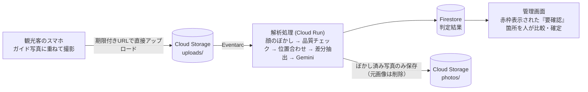

# KIZUKI（文化財見守りシステム）

観光客が撮影する「同じ構図の1枚」を蓄積し、城の石垣をはじめとする文化財のわずかな変化を早期発見するシステムです。

GDGoC Japan DevFest Hackathon 2026（観光カテゴリ）出品作品

> **※ AIの役割は「要確認」のフラグを立てるまでに留まります。「変化あり」と最終確定するのは、必ず人（管理者・専門家）が行います。**

## デモ動作環境

| 画面 | URL | 補足 |
| --- | --- | --- |
| 撮影画面（観光客用） | https://kizuki-capture.web.app/capture/Po64T4hV6CrRfnGxGs7m | デモ用の撮影スポット（名古屋城）です。スマートフォンでアクセスするとカメラが起動し、半透明のガイド写真に重ねて撮影できます。 |
| 管理画面（管理者・専門家用） | https://kizuki-admin.web.app | ログイン不要で、どなたでもアクセスできます（デモ公開中。データの変更も可能です）。画面の詳細は、以下の画像を参照してください。 |

| 比較・確定画面（管理画面） | 保存画像のレイアウト編集（管理画面） |
| --- | --- |
|  |  |

## 開発背景・目的

石垣をはじめとする文化財の保全調査には、3Dレーザー計測や写真測量といった精密な手法が用いられます。しかし、これらは高コストかつ多大な手間を要するため、頻繁に実施することは困難です。そのため、定期計測の合間に生じるわずかな変化（石の緩み・亀裂・はらみ出し、草木の侵入など）は、次回の調査まで見落とされてしまうという課題があります。

一方で、城郭には連日多くの観光客が訪れ、同じような場所からスマートフォンで撮影を行っています。KIZUKIは、それらの写真を「同じ構図」に位置合わせして収集し、過去の画像と比較します。本システムの目的は精密計測の代替ではなく、専門家が優先して現地調査すべき箇所を特定するための「一次スクリーニング（点検）」です。

## システム仕組み・解析フロー



解析は「画像処理による候補絞り込み」と「Geminiによる意味判定」の2段階で行います。画像処理単体では影と亀裂を区別しにくく、Gemini単体で全体比較を行うと細部を見落とすリスクや処理コストが増大するためです。

1. **プライバシー保護（顔のぼかし）**: Cloud Vision APIで人物の顔を検出し、自動でぼかし処理を施します。ぼかし処理後の画像のみを保存し、元画像は即座に削除します。
2. **品質チェック**: 写真のブレや暗さは数値指標で判定し、被写体の遮蔽や逆光の有無はGeminiで評価します。基準を満たさない画像は保存せず、非採択理由のみを記録します。
3. **位置合わせ（アライメント）**: OpenCV（SIFT + RANSAC）を活用し、撮影画像をガイド写真の画角に正確に合わせます。
4. **動体除外**: Cloud Visionの物体検出機能で人物や車両の領域を特定し、比較対象から除外することで、人の動きを構造的な変化と誤認するのを防ぎます。
5. **差分・候補抽出**: 明度を整えた上で画像差分を取得し、変化が大きい領域を切り出します。
6. **変化判定（Gemini）**: 切り出した前後の画像領域とチェック項目をGeminiに入力し、JSON（構造化出力）で結果を取得します。天候や光の当たり方、季節変化による差異は誤検知とみなさないようプロンプトで制御しています。

### 設計方針

* **AIによる自動確定の排除**: 管理画面にも「AIの判定です。確定は管理者が行います」と明記しています。
* **位置情報の非取得**: 観光客のGPSなどの位置情報は取得・保存しません。
* **個人情報の最小保持**: アップロードされた元画像は処理後すぐに削除されます。処理失敗時にも最大1日で自動削除されるようライフサイクルルールを設定しています。
* **APIキー非使用のセキュリティ設計**: Geminiとの連携はVertex AIを経由し、サービスアカウント認証を利用しています。
* **低コストなローカル開発構成**: ローカル環境ではGeminiやVision APIを呼び出さないモックモードに切り替えて実行できます。

## 主な機能

| 利用者 | 提供機能 |
| --- | --- |
| 観光客（スマートフォン） | 二次元コードを読み取るだけで、半透明のガイド写真に重ねて簡単に撮影可能（ログイン不要）。ガイドと構図が重なると自動でシャッターが切れます。撮影した写真は、**管理者が設定した案内文付きの記念画像**として保存・持ち帰りができます。 |
| 管理者・専門家（PC） | マップ上で撮影ポイントの登録・ステータス管理が可能です。「要確認」に分類された写真をガイド写真と並列（または重ね合わせ）で比較し、「変化あり」「誤検知」「経過観察」の判定を確定します。持ち帰り用画像のレイアウト編集も行えます。 |

### 保存画像のレイアウト設定機能

観光客がダウンロードする画像は、撮影写真に管理者が作成した案内文やロゴを合成した1枚の画像です。管理者はPowerPoint感覚の直感的な画面でレイアウトを編集できます。

* **画面の向きに応じた最適化**: 縦構図・横構図それぞれ専用のレイアウトを作成でき、スマートフォンの撮影向きに合わせて自動選択されます。
* **利用可能コンポーネント**: 写真フレーム、テキスト（縦書き・横書き、フォントサイズ、カラー、背景色）、図形、画像（ロゴ等）。
* **完全なWYSIWYG描画**: 編集画面とスマートフォン側で同一の描画ロジックを使用しているため、プレビュー通りの画像が生成されます。
* ※画像加工処理はスマートフォン端末側の保存用コピーに対してのみ行われ、解析サーバーに送信される画像データには一切影響しません。

## 使用している Google Cloud / Firebase 技術

| 技術要素 | 用途・役割 |
| --- | --- |
| Vertex AI（Gemini） | 変化の判定、および被写体の遮蔽・逆光のチェック（JSON形式の構造化出力を使用） |
| Cloud Run | APIサーバーおよび解析処理用コンテナ。解析処理は非公開環境にてリクエスト時のみ起動 |
| Eventarc | Cloud Storageへの画像アップロード完了をトリガーに解析処理を自動起動 |
| Cloud Vision | 人物の顔検出（ぼかし処理用）および人物・車両の検出（動体除外用） |
| Firestore / Cloud Storage | 判定データおよび画像ファイルの保管。署名付きURL（Signed URL）によりブラウザから安全に直接やり取り |
| Firebase Hosting / Authentication | フロントエンド配信。観光客側は匿名認証、管理者側は通常はGoogleアカウント認証（デモ公開中は、ログイン不要） |
| Maps JavaScript API | 管理画面における撮影ポイントの地図表示 |
| Cloud Build / Artifact Registry | コンテナイメージの自動ビルドおよびリポジトリ管理 |

## ローカル環境での動作手順（約5分）

クラウド環境を用意することなく、PC1台で撮影から管理画面での確認まで一通り試すことができます。（データはメモリ上で保持されるため、プロセスを停止するとリセットされます）

**動作前提条件:** Windows環境、Python 3.12、Node.js 24（npm 11）

### 1. セットアップ（初回のみ・PowerShell）

```powershell
cd C:\Users\haruk\Documents\KIZUKI
python -m venv .venv
.venv\Scripts\python -m pip install -r services/api/requirements.txt -r services/analyzer/requirements.txt pytest httpx
cd apps\capture; npm install
cd ..\admin; npm install
cd ..\..
```

※ディレクトリパスはご自身の環境に合わせて適宜読み替えてください。

### 2. サービスの起動（PowerShellウィンドウを3つ開いて実行）

| # | コンポーネント | 実行コマンド | アクセスURL |
| --- | --- | --- | --- |
| ① | API | `cd services\api` → `..\..\.venv\Scripts\python -m uvicorn app.main:app --port 8080` | http://localhost:8080 |
| ② | 管理画面 | `cd apps\admin` → `npm run dev` | http://localhost:5174 |
| ③ | 撮影画面 | `cd apps\capture` → `npm run dev` | http://localhost:5173/capture/spot0001 |

※API起動時に、デモ用の撮影スポット（`spot0001`）と「要確認」データが1件自動生成されます。

### 3. 動作確認手順

1. 管理画面（②）にアクセスし、「**開発用ログイン**」をクリックします。
2. マップから撮影スポットを選択し、「**レイアウトを編集**」で保存用画像の案内文を設定して保存します。
3. 撮影画面（③）を開いて撮影を行い、「**保存**」を押して案内文付き画像が生成されることを確認します。
4. 管理画面の「**要確認**」タブから、比較画面（赤枠表示）での差分確認と判定の確定をテストします。

### Google Mapsを表示する場合（任意）

管理画面の地図表示にはGoogle Mapsを利用しています。APIキーを設定しなくても地図以外の基本機能は動作します。

1. Google Cloud Consoleで **Maps JavaScript API** を有効化し、APIキーを作成します（HTTPリファラー制限を設定してください）。
2. `apps/admin/.env.example` を `apps/admin/.env.local` にコピーし、`VITE_GOOGLE_MAPS_API_KEY=` にキーを記述します。
3. 管理画面を再起動します。

※ `.env.local` はGit管理から除外されています。**APIキーをリポジトリ内に直接記述しないようご注意ください。**

## iPhone実機で撮影テストを行う場合

iPhoneのカメラ機能はHTTPS環境でのみ動作します。PCとiPhoneを**同一のWi-Fiネットワーク**に接続した上で、以下の手順で起動してください。

1. PCのIPアドレスを確認します（PowerShellで `ipconfig` を実行し、Wi-Fiの「IPv4 アドレス」を確認。※例: `192.168.3.3`）。
2. APIを以下の環境変数を指定して起動します（手順②の代わり）。
   ```powershell
   cd services\api
   $env:CAPTURE_BASE_URL = "https://192.168.3.3:5173"
   ..\..\.venv\Scripts\python -m uvicorn app.main:app --port 8080
   ```
3. 撮影画面をモバイルモードで起動します（手順③の代わり）。
   ```powershell
   cd apps\capture
   npm run dev:phone
   ```
4. iPhoneのSafariで `https://192.168.3.3:5173/capture/spot0001` にアクセスし、自己署名証明書の警告が表示された場合は「詳細を表示」→「このWebサイトを閲覧」を選択して進みます。

※接続できない場合は、同一Wi-Fiに接続されているか（ゲストWi-Fi等の端末間通信制限の有無）、Windowsファイアウォールでポート5173が許可されているか、IPアドレスが変更されていないかをご確認ください。詳細は [docs/local-dev.md](docs/local-dev.md) を参照してください。

## 本物のGemini APIを使用する場合

デフォルトでは、Geminiおよび顔検出処理はモックモードで動作します（モックモードでは差分検出箇所をすべて「変化あり」と返すため、精度の実測は行えません）。実際のAPIを利用する場合は、API起動前に以下の環境変数を設定してください。

```powershell
$env:JUDGE_MODE = "vertex"
$env:GOOGLE_CLOUD_PROJECT = "<ご自身のプロジェクトID>"
$env:GOOGLE_CLOUD_LOCATION = "global"
$env:GEMINI_MODEL_FAST = "gemini-3.8-flash"
```

認証には `gcloud auth application-default login` で保存された認証情報が使用されます。**APIキーの直接記述は不要です。** API利用料が発生するため、テスト終了後は環境変数を解除してください。

## テストの実行

```powershell
cd services\analyzer; ..\..\.venv\Scripts\python -m pytest
cd ..\api;            ..\..\.venv\Scripts\python -m pytest
cd ..\..\apps\capture; npm test
cd ..\admin;           npm test
```

## ディレクトリ構成

| ディレクトリ | 役割・内容 |
| --- | --- |
| `apps/capture` | 観光客向け撮影画面（React + Vite、PWA対応） |
| `apps/admin` | 管理者向け管理画面（React + Vite） |
| `services/api` | バックエンドAPI（FastAPI） |
| `services/analyzer` | 画像解析・判定処理エンジン（OpenCV + Gemini） |
| `shared` | 共有データ型定義、保存画像描画ロジック、ストレージ/DBインターフェース |
| `infra` | Firestore / Cloud Storageセキュリティルール、デプロイ手順 |
| `experiments` | 精度検証・実験用スクリプト群 |
| `docs` | アーキテクチャ設計書、ローカル開発ガイド、デモ手順書 |

※ストレージやデータベース層はインターフェース（ポート）を介して抽象化されています。ローカル環境ではインメモリ実装、本番クラウド環境ではFirestoreおよびCloud Storageへ容易に切り替えが可能です。

**各種ドキュメント:** [全体アーキテクチャ](docs/architecture.md) ／ [ローカル開発ガイド](docs/local-dev.md) ／ [デモシナリオ](docs/demo.md) ／ [デプロイ手順書](infra/DEPLOY.md) ／ [設計思想・前提（CLAUDE.md）](CLAUDE.md)

## 現在の開発状況

| 項目 | ステータス |
| --- | --- |
| ローカル環境での「撮影 → 解析 → 管理画面確認」の一連フロー | 動作確認済み |
| 実写データ（名古屋城の同一構図 8組）における誤検知率 | 誤検知 0件（Gemini呼び出し 39回） |
| クラウド環境へのデプロイ（Cloud Run / Firebase Hosting / Firestore / Eventarc） | デプロイ完了。撮影から解析・データ保存までの動作を確認済み（[infra/DEPLOY.md](infra/DEPLOY.md)） |
| 顔ぼかし処理（Vision API）および品質判定（Gemini） | クラウド環境上での動作を確認済み |
| 保存画像のレイアウト編集機能 | ブラウザ上での検証完了（iPhone実機での描画検証は未実施） |
| 見落とし（偽陰性）率の検証 | 合成変化画像による検証を実施（`experiments/miss_check.py`）。画像差分抽出フェーズでの見落としは0件。Geminiは亀裂や平坦なシール（落書き・汚損）を安定して検出できる一方、合成によるズレた石の検出能力にはばらつきが見られます。なお、熊本城の実際の崩落の前後写真（1組）は、3回判定して3回とも検出できました（ほかの組は検出なし、または視点が違いすぎて位置合わせに失敗）。実写「変化なし」データ（8組）での誤検知は0件（`experiments/regress_prod.py`）。※実物の損傷石垣での網羅的検証は未実施 |
| App Checkの導入 | 現在は無効（無効の間は、投稿回数の制限を回避されるおそれがあります。公開を続けるなら有効化が必要） |
| 変化検知時の通知機能（FCM） | 未実装 |
| 多言語対応 | 未対応（現時点では日本語のみ） |

## 今後の課題

* **検出限界の定量化**: 実際の損傷やシール貼り付け等の擬似変化画像を用い、検知可能な最小サイズ・変化量を検証。
* **App Checkの有効化**: 公開運用に向けたセキュリティ・リクエスト制限の強化。
* **通知機能（FCM）およびダッシュボード機能の実装**: 変化検知時の管理者へのリアルタイム通知と集計画面の構築。
* **多言語UI対応**: 訪日外国人観光客向けの案内・画面表示の多言語化。

## リポジトリに含まれないファイル

* 秘密情報（`.env`、`.env.local`、各種APIキーなど）
* サンプル画像データ（`ishigaki_samples/images`、`ishigaki_change_pairs/photos`）。※Wikimedia Commons等の大容量画像であり、ライセンスが個別に異なるため除外しています。出典およびライセンス一覧（`licenses.csv`）のみ同梱しています。
* 独自に撮影した実写写真（`実写サンプル/`、`experiments/samples/`）。※人物や特定の場所が含まれる可能性があるため除外しています。
* 仮想環境（`.venv`）、`node_modules`、実験出力ログ等の生成物

## ライセンス

[MIT License](LICENSE)
※ただし `ishigaki_samples` および `ishigaki_change_pairs` に含まれる画像データについては、それぞれの提供元のライセンスに従います（詳細は各フォルダ内の `licenses.csv` を参照してください）。
